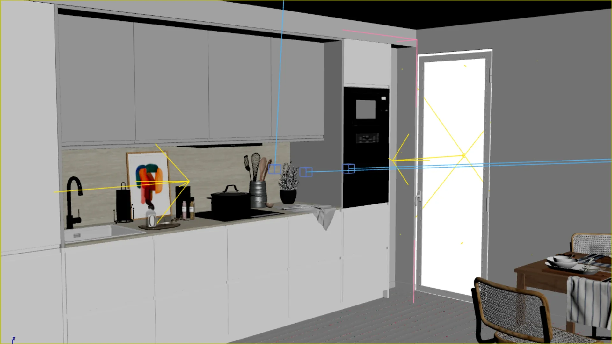
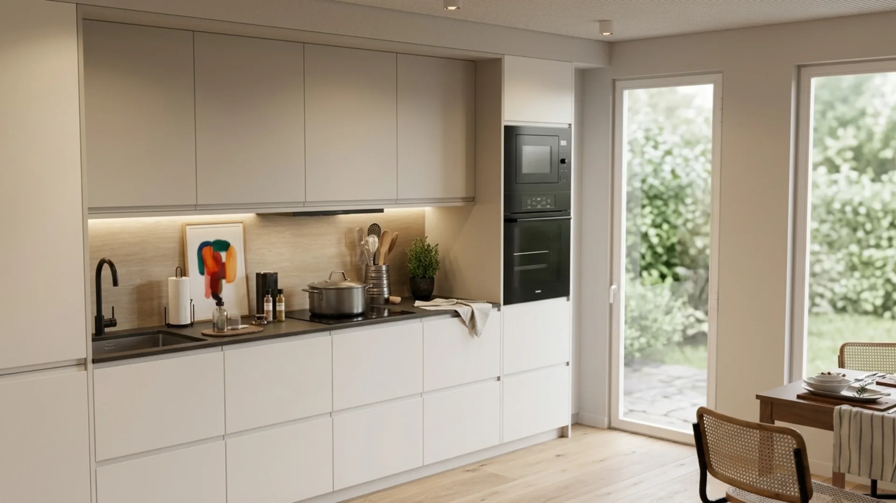

# 3DKLYN

**AI images and video inside your 3ds Max workflow.**

Explore lighting, materials and image edits, or turn an architectural image into a video. Start with a viewport frame, a completed render or an image file. Use your own cloud provider keys or an existing local ComfyUI installation.

**[Download personal beta](https://github.com/3dklyn/3dklyn-plugin/releases/latest)** · [Website and examples](https://3dklyn.com/) · [Installation guide](docs/INSTALLATION.md) · [Get support](https://3dklyn.com/messages.html)

## From viewport to image

| Source viewport | AI result · Gemini |
| --- | --- |
|  |  |

Illustrative example from [3dklyn.com](https://3dklyn.com/ai-viewport-3ds-max.html). AI can change geometry, proportions and details in the returned image. Compare the result with your source.

## What you can do

- Generate image variations from a render, viewport frame or image file.
- Guide a local image edit with a reference and mask.
- Explore lighting and materials, then compare before and after.
- Generate video from an image with a supported cloud provider.
- Use local image workflows through your own ComfyUI server.
- Review outputs in History and save images or video.

See [the website](https://3dklyn.com/) for visual examples and [the full guide](https://3dklyn.com/guide.html) for provider setup. Some models and advanced options remain experimental. Generated images and video do not edit your 3D scene geometry or materials.

## Current release

| | Personal beta |
| --- | --- |
| Version | **1.34.27 · Build 97** |
| Platform | Windows |
| Verified host | 3ds Max 2025: installation, restart and removal |
| Access | No 3DKLYN registration or activation |
| Use | Personal, non-commercial testing |
| Generation costs | Cloud provider charges are separate; model files are not bundled |

Other 3ds Max versions have not been verified. These host checks do not establish that every provider or model works on every machine. The beta has no fixed end date; its [existing terms](https://3dklyn.com/legal/terms.html) apply.

## Start here

1. Download the `.mzp` from [Releases](https://github.com/3dklyn/3dklyn-plugin/releases/latest) and [verify its checksum](docs/VERIFY.md).
2. Save your work and open a fresh 3ds Max session.
3. Choose **Scripting → Run Script**, select the MZP, read the Personal Beta Terms and click **Install beta**.
4. Open **API**, configure your own provider key or ComfyUI server, then try one small image.

Follow the [installation and first-generation guide](docs/INSTALLATION.md) for the full steps. Updates are manual; keep the original MZP for removal.

## Help and feedback

- **Setup or private support:** [3dklyn.com/messages.html](https://3dklyn.com/messages.html) or [support@3dklyn.com](mailto:support@3dklyn.com).
- **Reproducible bugs:** [open an issue](https://github.com/3dklyn/3dklyn-plugin/issues/new/choose) with the build, Max version, provider, model and steps.
- **Suggestions:** use the feature-request template.

Review diagnostics before posting. Keep API keys, passwords, private project files and confidential images out of public issues.

## Licence and distribution

This repository provides public release information, documentation and downloads. The packaged beta is distributed under the [3DKLYN Personal Beta Licence](https://3dklyn.com/legal/license.html). It permits personal, non-commercial evaluation; client work and studio production are outside this beta permission. Original 3DKLYN code is not offered under an open-source licence here.

Third-party software and models retain their own terms. See the [third-party notices](https://3dklyn.com/THIRD-PARTY-NOTICES.txt), [privacy notice](https://3dklyn.com/legal/privacy.html) and [release verification](docs/VERIFY.md).

3ds Max is an Autodesk trademark. Provider and model names belong to their respective owners.
